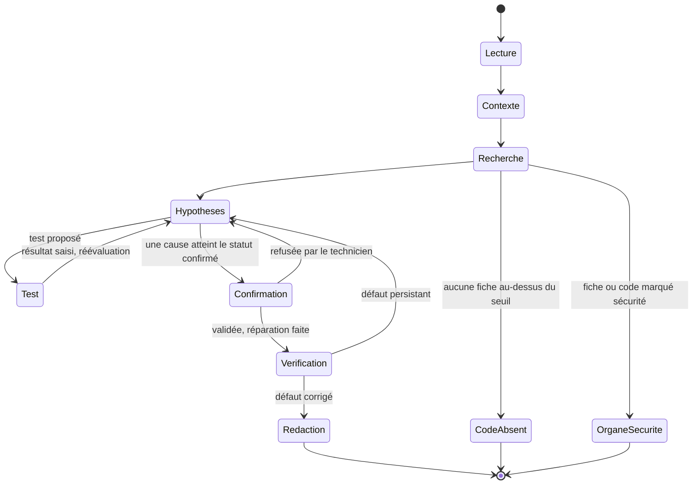

# MécaPilot — Spécification technique de l'agent

Version de travail · Techathon 6 · novembre 2026

Ce document décrit tout ce que fait l'agent, de la lecture du véhicule jusqu'au dossier de garantie : phases, outils, garde-fous, formats de données et priorités pour le prototype. Il complète `contexte11.md` (projet) et l'étude concurrentielle (positionnement).

**Principe directeur** : l'agent propose, le technicien décide. Chaque affirmation de l'agent repose sur une mesure lue ou sur une fiche validée ; sinon, il ne l'affirme pas.

---

## 1. Vue d'ensemble

### 1.1 Ce que fait l'agent, en une ligne par phase

|#|Phase|Ce que fait l'agent|Outils principaux|
|---|---|---|---|
|1|Lecture|Lit codes défauts, données figées, mesures live et VIN ; vérifie que les mesures sont plausibles|`lire_dtc`, `lire_donnees_figees`, `lire_pid`, `verifier_plausibilite`|
|2|Contexte|Enregistre les symptômes décrits par le technicien (texte, puis voix)|—|
|3|Recherche|Cherche les fiches correspondant aux codes et symptômes ; refuse si rien n'est trouvé|`chercher_doc`, `croiser_codes`|
|4|Hypothèses|Classe les causes probables, chacune avec ses preuves et sa source|sortie structurée|
|5|Guidage|Propose le test le plus utile, intègre le résultat, réévalue|`choisir_test`, `reevaluer`, `detecter_contradiction`|
|6|Confirmation|Attend la confirmation de la cause par le technicien|—|
|7|Vérification|Après réparation, relit le véhicule et compare avant / après|`effacer_dtc`, `verifier_reparation`|
|8|Rédaction|Génère rapport d'intervention, dossier de garantie et temps passé|`mesurer_temps_diagnostic`, `rediger_rapport`, `rediger_dossier_garantie`|

### 1.2 Machine à états

L'agent ne peut changer d'état que par une action du technicien ou par une règle codée. Le LLM ne décide pas seul d'une transition.



`CodeAbsent` et `OrganeSecurite` sont des sorties normales, pas des erreurs : l'agent affiche un message fixe, enregistre le motif au journal et s'arrête.

### 1.3 Répartition des responsabilités : code ou LLM

Décision clé du projet : **tout ce qui doit être exact ou reproductible est fait en code ; le LLM orchestre, interprète le langage naturel et rédige.**

|Tâche|Fait par|Raison|
|---|---|---|
|Lire le véhicule, normaliser les unités|Code|Exactitude|
|Contrôle de plausibilité des mesures|Code (règles des fiches)|Reproductible, testable|
|Recherche documentaire, seuil de pertinence|Code (RAG)|Seuil vérifiable|
|Associer symptômes libres et fiches|LLM|Langage naturel|
|Classement initial des causes|LLM, contraint par les causes de la fiche|Le LLM ne peut pas inventer une cause hors fiche|
|Choix du test suivant|Code (score), LLM (explication)|Choix justifiable et testable|
|Réévaluation après un test|Code (table d'effets de la fiche)|Pas d'oubli, pas de dérive|
|Validation des citations, sécurité, schéma JSON|Code|Garde-fous non contournables|
|Chiffres dans les rapports|Code (injectés depuis le journal)|Le LLM n'écrit jamais un chiffre|
|Texte narratif des rapports|LLM, relu par le technicien|Lisibilité|

---

## 2. Phase 1 — Lecture du véhicule

### 2.1 Interface d'acquisition

L'agent ne connaît que la classe abstraite `Source`. On change de source par un paramètre de configuration.

```python
class Source(ABC):
    def lire_vin(self) -> str | None: ...
    def lire_dtc(self) -> dict: ...            # {"stockes": [...], "en_attente": [...]}
    def lire_donnees_figees(self) -> dict: ...
    def lire_pid(self, nom: str) -> Mesure: ...
    def lire_statut(self) -> dict: ...         # voyant, nombre de codes, moniteurs
    def pids_supportes(self) -> list[str]: ...
    def effacer_dtc(self) -> bool: ...

# Implémentations : Emulateur, Banc (ESP32 + transceiver CAN), Voiture (ELM327 réel)
```

Correspondance avec les services OBD-II :

|Méthode|Service OBD-II|Remarque|
|---|---|---|
|`lire_vin`|09, PID 02|Peut être absent sur véhicules anciens|
|`lire_dtc` stockés|03|Codes confirmés|
|`lire_dtc` en attente|07|Utile pour vérifier une réparation|
|`lire_donnees_figees`|02|**Perdues après effacement** : toujours lues et journalisées avant|
|`lire_pid`|01|Mesures live|
|`lire_statut`|01, PID 01|Voyant, nombre de codes, état des moniteurs|
|`effacer_dtc`|04|Action à effet de bord, confirmation obligatoire|

Limite à connaître : l'OBD-II générique couvre surtout le groupe motopropulseur et l'antipollution. Les codes châssis (C), carrosserie (B) et réseau (U) des freins, airbags ou direction sont souvent lisibles uniquement avec l'outil du constructeur.

### 2.2 Objet `Mesure`

```json
{
  "pid": "LONG_FUEL_TRIM_1",
  "valeur": 18.0,
  "unite": "%",
  "horodatage": "2026-11-14T10:32:05Z",
  "conditions": {"regime_tr_min": 780, "temp_moteur_c": 89},
  "plausible": true,
  "source": "emulateur"
}
```

Pour les mesures sur une durée (test à 2 000 tr/min), l'outil renvoie un résumé statistique (min, max, moyenne, nombre d'échantillons) plutôt que les valeurs brutes. Le LLM raisonne mieux sur un résumé et consomme moins de contexte.

### 2.3 `verifier_plausibilite`

Avant d'utiliser une mesure, l'agent vérifie qu'elle est physiquement possible. Une mesure implausible signale un capteur ou un câblage défaillant, pas forcément une panne du système mesuré.

Règles stockées dans les fiches et dans un fichier commun `data/plausibilite.yaml` :

|Règle|Interprétation|
|---|---|
|Température moteur = −40 °C|Circuit capteur ouvert|
|Débit d'air = 0 g/s avec régime > 500 tr/min|Débitmètre ou connexion|
|Régime = 0 avec vitesse > 0|Incohérence de lecture|
|Valeur figée identique sur 30 s moteur en charge|Capteur bloqué ou trame non rafraîchie|

Sortie : la mesure reçoit `"plausible": false` et une alerte est ajoutée. **Une mesure implausible ne peut pas servir de preuve à une cause** (règle codée).

---

## 3. Phase 2 — Contexte

Le technicien ajoute ce qu'il a constaté : bruit, à-coups, conditions d'apparition, réclamation du client. Ce texte est enregistré tel quel au journal (`symptome_saisi`).

- **Version prototype** : saisie texte.
- **Extension voix** : une couche de transcription produit du texte ; l'agent reste indépendant de la langue. La transcription doit gérer le mélange darija + termes techniques français. **Toute valeur chiffrée dictée est réaffichée et confirmée à l'écran avant d'être utilisée.**

---

## 4. Phase 3 — Recherche documentaire

### 4.1 `chercher_doc`

```json
// entrée
{"codes": ["P0171"], "symptomes": "ralenti instable à froid", "marque": "X"}

// sortie
{
  "resultats": [
    {"fiche": "F-012", "section": "causes", "score": 0.82,
     "passage": "…", "organe_securite": false}
  ],
  "sous_seuil": false
}
```

- Fiches découpées par section, avec métadonnées : identifiant, codes couverts, organe de sécurité oui/non.
- **Seuil de pertinence** : sous le seuil, la liste est vide et `sous_seuil` vaut `true`. L'agent passe alors à l'état `CodeAbsent`.
- Chaque identifiant renvoyé est enregistré au journal : seuls ces identifiants pourront être cités ensuite (voir garde-fou G1).

### 4.2 `croiser_codes` (bonus)

Quand plusieurs codes sont présents, l'outil cherche une cause commune déclarée dans les fiches. Exemple : P0171 et P0174 ensemble (deux rangées pauvres) orientent vers une cause commune aux deux rangées (prise d'air, débitmètre, pression carburant) plutôt qu'un injecteur isolé.

---

## 5. Phase 4 — Hypothèses

### 5.1 Règles

- Les causes proposées sont **uniquement celles listées dans les fiches trouvées**.
- Chaque cause porte au moins une preuve (mesure plausible ou symptôme saisi) et au moins une source.
- La probabilité est exprimée en niveaux (`haute`, `moyenne`, `faible`), pas en pourcentage : un pourcentage donnerait une fausse impression de précision.
- Statut de chaque cause : `ouverte`, `renforcee`, `affaiblie`, `eliminee`, `confirmee`.

### 5.2 Sortie structurée de l'agent (à chaque tour)

Validée par un schéma JSON avant affichage. En cas d'échec : une nouvelle tentative, puis message d'erreur au technicien.

```json
{
  "etat": "hypotheses",
  "causes": [
    {
      "id": "C1",
      "libelle": "Prise d'air à l'admission après le débitmètre",
      "statut": "renforcee",
      "probabilite": "haute",
      "preuves": [
        {"type": "mesure", "pid": "LONG_FUEL_TRIM_1", "valeur": 18.0, "unite": "%"},
        {"type": "test", "test": "T1", "resultat": "correction normalisée à 2 000 tr/min"}
      ],
      "sources": [{"fiche": "F-012", "section": "causes"}]
    }
  ],
  "test_suivant": {
    "id": "T2",
    "description": "Contrôle d'étanchéité de l'admission (machine à fumée)",
    "duree_min": 10,
    "outillage": ["machine à fumée"],
    "causes_discriminees": ["C1"],
    "justification": "Confirme ou élimine directement la cause la plus probable",
    "source": {"fiche": "F-012", "section": "tests"}
  },
  "alertes": [],
  "manque_pour_conclure": ["résultat du contrôle d'étanchéité"]
}
```

---

## 6. Phase 5 — Guidage test par test

### 6.1 `choisir_test`

Classe les tests disponibles dans les fiches selon un score calculé en code :

```
score(test) = nombre de causes ouvertes dont le statut changerait selon le résultat
              / (durée en minutes + pénalité d'outillage)
```

- Les tests déjà faits sont exclus.
- Les tests dont l'outillage n'est pas disponible à l'atelier sont signalés, pas cachés.
- Le LLM rédige seulement la justification en langage clair : « ce test élimine 2 causes sur 3 en 2 minutes, sans outillage ».

### 6.2 `reevaluer`

Chaque test de la fiche déclare l'effet de chacun de ses résultats sur les causes. La mise à jour est appliquée en code, puis le LLM reformule.

Exemple pour P0171 (fiche F-012) :

|Test|Durée|Outillage|Résultat|Effet|
|---|---|---|---|---|
|T1 · Correction de mélange au ralenti puis à 2 000 tr/min|2 min|Aucun|Se normalise à 2 000 tr/min|C1 renforcée ; C2, C3 affaiblies|
||||Reste élevée|C2, C3 renforcées ; C1 affaiblie|
|T2 · Contrôle d'étanchéité de l'admission|10 min|Machine à fumée|Fuite visible|C1 confirmée|
|T3 · Débit d'air au ralenti comparé à la plage de la fiche|2 min|Aucun|Sous la plage|C2 renforcée|
|T4 · Pression carburant au manomètre|15 min|Manomètre|Sous la plage|C3 confirmée|

Causes de la fiche : C1 prise d'air, C2 débitmètre encrassé, C3 pression carburant insuffisante, C4 injecteurs colmatés.

Une cause ne passe à `confirmee` que si un test de la fiche le prévoit explicitement **et** que le technicien valide.

### 6.3 `detecter_contradiction` (bonus)

Si le résultat saisi par le technicien contredit une mesure lue (par exemple « correction normale » alors que la lecture indique +18 %), l'agent ne poursuit pas : il signale l'écart et propose de refaire la mesure.

---

## 7. Phases 6 et 7 — Confirmation et vérification de la réparation

### 7.1 Confirmation

Quand une cause atteint `confirmee`, l'agent demande la validation du technicien. Un refus renvoie aux hypothèses avec la cause marquée `contestee` dans le journal.

### 7.2 `verifier_reparation`

Ferme la boucle : la réparation est prouvée par des mesures, pas seulement déclarée.

1. Vérifier que codes et données figées sont déjà au journal (ils seront perdus à l'effacement).
2. Demander la confirmation explicite du technicien, puis `effacer_dtc`.
3. Faire refaire le test de contrôle de la fiche dans ses conditions (moteur chaud, régime indiqué).
4. Relire codes stockés et en attente, et les mesures clés.
5. Comparer avant / après.
6. Relever l'état des moniteurs. Après un effacement, ils repassent « non prêts » : le rapport indique qu'un cycle de conduite est nécessaire pour les compléter. **On n'affirme jamais « moniteurs prêts » juste après un effacement.**

```json
{
  "corrige": true,
  "codes_apres": {"stockes": [], "en_attente": []},
  "comparaison": [
    {"pid": "LONG_FUEL_TRIM_1", "avant": 18.0, "apres": 2.0, "unite": "%",
     "plage_reference": [-10, 10], "source": {"fiche": "F-012", "section": "plages"}}
  ],
  "moniteurs": "non prêts après effacement, cycle de conduite requis"
}
```

Si un code revient ou si une mesure reste hors plage : `corrige` vaut `false` et l'agent retourne aux hypothèses.

Avec l'émulateur, chaque scénario contient un état « après réparation » pour démontrer cette étape.

---

## 8. Phase 8 — Rédaction

Tous les documents sont générés **depuis le journal de session**. Les champs factuels (codes, mesures, dates, temps, références) sont injectés par un gabarit en code. Le LLM ne rédige que les phrases de liaison. Chaque document est un brouillon jusqu'à validation par le technicien.

### 8.1 `mesurer_temps_diagnostic`

Calcule les durées depuis les horodatages du journal :

|Indicateur|Calcul|
|---|---|
|Temps de diagnostic|`session_ouverte` → `cause_confirmee`|
|Temps par test|`test_propose` → `test_resultat`|
|Temps de vérification|`effacement_dtc` → `verification`|

Ces durées alimentent le dossier de garantie et la facturation. Elles répondent au problème du temps de diagnostic mal facturé.

### 8.2 `rediger_rapport` — rapport d'intervention

Contenu : identification du véhicule, réclamation, codes et mesures, démarche (tests et résultats), cause confirmée et source, réparation, vérification avant / après, temps passé.

Section optionnelle **Points de vigilance** (prévention sourcée), uniquement si la fiche la prévoit :

- pannes associées connues à contrôler au prochain passage ;
- mesures encore dans la tolérance mais proches de la limite ;
- campagnes de rappel ou bulletins non appliqués, si la base les contient ;
- entretien lié à la panne réparée.

Pas de prédiction de panne : chaque point cite sa fiche, sinon il n'apparaît pas.

### 8.3 `rediger_dossier_garantie`

Le dossier prouve au constructeur que la panne est réelle, que la démarche est conforme et que la pièce changée était la cause.

```json
{
  "vehicule": {"vin": "…", "kilometrage": 48200, "date": "2026-11-14"},
  "concession": "…", "technicien": "…",
  "reclamation_client": "Voyant moteur allumé, ralenti instable",
  "constat": {
    "codes_stockes": ["P0171"],
    "donnees_figees": {"regime_tr_min": 790, "LONG_FUEL_TRIM_1": 18.0}
  },
  "demarche": [
    {"test": "T1", "resultat": "correction normalisée à 2 000 tr/min",
     "source": {"fiche": "F-012", "section": "tests"}},
    {"test": "T2", "resultat": "fuite sur durite de recyclage des gaz du carter",
     "source": {"fiche": "F-012", "section": "tests"}}
  ],
  "cause_confirmee": {"libelle": "Prise d'air", "source": {"fiche": "F-012"}},
  "reparation": {"piece": "Durite de recyclage des gaz du carter", "reference": "saisie technicien"},
  "verification": {"corrige": true, "LONG_FUEL_TRIM_1": {"avant": 18.0, "apres": 2.0}},
  "temps_diagnostic_min": 34,
  "statut": "brouillon",
  "valide_par": null
}
```

Limites assumées :

- Format générique : chaque constructeur a son propre format et son portail. L'export vers un portail est une étape ultérieure.
- **L'agent ne décide pas si la réparation est couverte** par la garantie : c'est le rôle du chef d'atelier et du constructeur.
- Envoi impossible tant que `statut` ne vaut pas `valide`.

### 8.4 Rapport client (extension)

Même journal, langage simple, en français (darija en extension). Ne montre que le confirmé : cause, tests réalisés, pièces, points de vigilance. Pas les hypothèses écartées. Partage par PDF ou lien, après validation par le technicien ou le réceptionnaire. Pas de comptes clients dans le prototype.

---

## 9. Garde-fous codés

Ils sont appliqués par le code, entre la sortie du LLM et l'affichage. Le LLM ne peut pas les contourner.

|#|Garde-fou|Mise en œuvre|
|---|---|---|
|G1|Pas de cause sans source|Chaque source citée doit être un identifiant renvoyé par `chercher_doc` **dans cette session**. Sinon la réponse est rejetée|
|G2|Code absent de la base|`sous_seuil = true` → message fixe « code absent de la base », aucune déduction|
|G3|Organes de sécurité|Fiche marquée `organe_securite: true` ou code d'un système de freinage, direction ou airbag → aucune conclusion ; l'agent renvoie à la procédure constructeur et à un expert|
|G4|Validation humaine|Confirmation de cause, effacement des codes et validation des documents exigent une action du technicien|
|G5|Preuves valides|Une mesure `plausible: false` ne peut pas servir de preuve|
|G6|Causes bornées|Une cause hors des fiches trouvées est rejetée|
|G7|Sortie conforme|Schéma JSON validé à chaque tour|
|G8|Chiffres exacts|Toute valeur d'un rapport provient du journal ; un contrôle vérifie qu'aucun chiffre n'est absent du journal|

Chaque déclenchement d'un garde-fou est enregistré au journal (`refus`, avec son motif). C'est aussi une donnée d'évaluation.

---

## 10. Formats de données

### 10.1 Fiche (`data/fiches/F-012.md`)

```markdown
---
id: F-012
codes: [P0171, P0174]
marque: X
organe_securite: false
source: "Manuel de réparation marque X, chapitre …"
valide_par: "Nom, fonction"
---
## Symptômes
## Causes          (C1…C4, avec indices attendus)
## Tests           (id, description, durée, outillage, conditions, effets de chaque résultat)
## Plages          (valeurs de référence et règles de plausibilité)
## Vigilance       (prévention sourcée, optionnel)
```

### 10.2 Scénario (`data/scenarios/p0171_prise_air.json`)

```json
{
  "id": "p0171_prise_air",
  "vin": "…",
  "dtc": {"stockes": ["P0171"], "en_attente": []},
  "donnees_figees": {"RPM": 790, "LONG_FUEL_TRIM_1": 18.0},
  "pid": {
    "RPM": {"type": "fixe", "valeur": 780, "bruit": 15},
    "LONG_FUEL_TRIM_1": {"type": "fonction_regime", "ralenti": 18.0, "2000": 3.0, "bruit": 1.0}
  },
  "apres_reparation": {
    "dtc": {"stockes": [], "en_attente": []},
    "pid": {"LONG_FUEL_TRIM_1": {"type": "fixe", "valeur": 2.0, "bruit": 1.0}}
  }
}
```

Source de vérité unique : le tableau du firmware ESP32 est généré depuis ces fichiers.

### 10.3 Journal de session (`sessions/<id>.jsonl`)

Un événement par ligne, horodaté :

```
session_ouverte · lecture_dtc · lecture_donnees_figees · lecture_pid · alerte_plausibilite
symptome_saisi · recherche_doc · hypotheses_emises · test_propose · test_resultat
contradiction · cause_confirmee · cause_contestee · effacement_dtc · verification
document_genere · validation_technicien · refus
```

```json
{"t": "2026-11-14T10:41:12Z", "type": "test_resultat", "test": "T1",
 "mesures": {"LONG_FUEL_TRIM_1": {"ralenti": 18.0, "2000": 3.0}}, "saisi_par": "technicien"}
```

---

## 11. Évaluation

Fichier `eval/attendus.json` : pour chaque scénario, cause, fiche et premier test attendus, ainsi que le comportement attendu (diagnostic, refus « code absent », refus sécurité).

|Indicateur|Cible prototype|
|---|---|
|Cause correcte en tête après les tests|≥ 80 % des scénarios|
|Fiche citée correcte|100 %|
|Premier test proposé = test attendu|≥ 80 %|
|Réponses affichées sans source valide|0|
|Refus corrects (hors base, sécurité)|100 %|
|Chiffres de rapport absents du journal|0|

Ces chiffres sont des objectifs internes, à présenter comme tels au jury.

---

## 12. Organisation du dépôt

```
acquisition/   source.py, emulateur.py, banc.py, voiture.py, plausibilite.py
rag/           indexation.py, recherche.py
agent/         boucle.py, etats.py, schema_sortie.json
agent/outils/  choisir_test.py, reevaluer.py, verifier_reparation.py, croiser_codes.py
garde_fous/    citations.py, securite.py, chiffres.py
rapport/       gabarits/, temps.py, rapport.py, garantie.py
voix/          (extension)
eval/          attendus.json, lancer_eval.py
data/          fiches/, scenarios/, plausibilite.yaml
sessions/      journaux .jsonl
```

---

## 13. Priorités

|Niveau|Contenu|
|---|---|
|**Prototype de dimanche**|Lecture (émulateur), `verifier_plausibilite`, `chercher_doc` avec seuil, hypothèses sourcées, `choisir_test`, `reevaluer`, `verifier_reparation`, `mesurer_temps_diagnostic`, rapport et dossier de garantie, garde-fous G1 à G8, 3 scénarios dont un hors base et un sécurité|
|**Bonus si le temps le permet**|`croiser_codes`, `detecter_contradiction`, points de vigilance, banc ESP32|
|**Perspectives (slides)**|Voix français + darija, rapport client, `chercher_cas_atelier` et `proposer_fiche` (mémoire d'atelier), export vers portails de garantie, véhicule réel|
|**Exclu**|Prédiction de pannes, affinage d'un modèle, analyse du son moteur, comptes clients|

### Scénario de démonstration

1. P0171 lu sur l'émulateur, avec une mesure de débit d'air implausible signalée par `verifier_plausibilite`.
2. Causes classées avec preuve et fiche citée.
3. `choisir_test` justifie le premier test (2 min, sans outillage, discrimine 3 causes).
4. Réévaluation, puis confirmation de la prise d'air.
5. `verifier_reparation` : avant / après chiffré.
6. Dossier de garantie prêt, avec temps de diagnostic.
7. Robustesse : code hors base → « code absent de la base » ; code de freinage → refus de conclure.