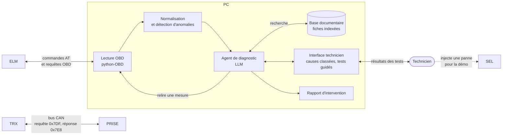

# Contexte du projet : copilote de dépannage pour mécaniciens


## 1. Résumé

**Nom provisoire** : MécaPilot.

**En une phrase** : un agent IA lit les codes défauts et les mesures d'un véhicule via OBD-II, cherche dans la documentation technique à la place du technicien, classe les causes probables, le guide test par test jusqu'à la panne, puis rédige le rapport d'intervention.
**Principe directeur** : l'agent propose, le technicien décide.
## 2. Cadre du hackathon

- **Événement** : Techathon 6, « AI for Real Impact, From Ideas to Intelligent Solutions », thème « AI new way of working », ouvert aux étudiants des écoles partenaires.
- **Challenge retenu** : Challenge 3, « Reinventing the Way We Work » (comment l'IA simplifie les activités quotidiennes et réduit les tâches répétitives).
- **Liens avec les autres challenges** : un volet Challenge 1 (IA agentique pour l'ingénierie) et des garde-fous qui relèvent du Challenge 4 (IA responsable et fiable).
- **Échéance** : dimanche 15 novembre 2026.
- **Livrable du dimanche** : formulaire avec description de l'idée. Un prototype à cette date est un objectif de l'équipe, à confirmer comme exigence du règlement.
- **Soumission** : formulaire Microsoft Forms.

Les quatre challenges de l'édition :

|Challenge|Intitulé|Question|
|---|---|---|
|1|AI / Agentic AI for Engineering Excellence|Comment l'IA générative simplifie, accélère ou améliore les activités d'ingénierie ?|
|2|Human-Centric AI / Agentic AI|Comment créer des expériences plus intelligentes en gardant l'humain au centre ?|
|3|Reinventing the Way We Work|Comment l'IA simplifie les activités quotidiennes et réduit les tâches répétitives ?|
|4|AI / Agentic AI for Responsible Innovation|Comment construire des solutions utiles, accessibles et fiables en maîtrisant les risques ?|

## 3. Équipe et contraintes

- **Taille** : 4 personnes ou plus.
- **Compétences** : à confirmer. Une réponse indique « aucune » parmi Python, web, IA et mécanique automobile, alors que le plan de travail suppose trois profils (informatique, électrique, mécanique).
- **Matériel disponible au départ** : aucun (ni adaptateur, ni véhicule de test, ni documentation technique).
- **Budget** : non défini. Les modules transceiver CAN coûtent quelques dizaines de MAD.

## 4. Cible et problème

**Utilisateur cible** : le technicien d'atelier en concession ou réseau de marque. Le décideur est le chef d'atelier.

**Problème général** : un code défaut OBD-II indique un symptôme, pas la cause. Un P0171 (mélange trop pauvre) peut venir d'une prise d'air, d'un débitmètre encrassé, d'une pompe à carburant faible ou d'un injecteur bouché.

**Problèmes propres aux concessions** :

- La documentation officielle est massive et lente à parcourir (manuels de réparation, bulletins techniques, campagnes de rappel).
- Les techniciens juniors dépendent d'experts rares et très sollicités.
- Les diagnostics sous garantie doivent être justifiés auprès du constructeur.
- Le temps de diagnostic est souvent mal facturé.

**Trois tâches répétitives supprimées** (argument central pour le Challenge 3) :

1. **Chercher** : parcourir manuels et bulletins pour chaque code défaut.
2. **Recouper** : comparer à la main les mesures du véhicule aux valeurs de référence.
3. **Rédiger** : saisir le rapport d'intervention et la justification de garantie.

**Avantage du choix concession** : une seule marque à couvrir, donc une base documentaire limitée et un agent plus fiable.

## 5. Solution

### Fonctionnement

1. **Lecture** : l'adaptateur transmet les codes défauts (DTC), les données figées (freeze frame), les mesures en direct et, si possible, le VIN.
2. **Contexte** : le technicien ajoute les symptômes observés, par texte ou par voix.
3. **Recherche** : l'agent interroge la base documentaire indexée (RAG).
4. **Hypothèses** : il affiche les causes classées par probabilité, chacune justifiée par une mesure et une source.
5. **Guidage** : il propose les tests du plus simple au plus complexe. Le technicien saisit chaque résultat et l'agent réévalue ses hypothèses.
6. **Clôture** : une fois la cause confirmée, l'agent génère le rapport d'intervention.

### Ce qui le distingue d'un lecteur OBD classique

Un lecteur classique affiche le code et sa définition. Le copilote croise plusieurs codes et les mesures réelles, cite ses sources et s'adapte aux résultats des tests.

### Garde-fous

- Chaque réponse cite son document source.
- L'agent refuse de conclure sans source.
- Le technicien valide chaque étape.
- Aucune conclusion autonome sur les organes de sécurité (freins, direction, airbags).
- Les garde-fous sont vérifiés en code, pas seulement demandés au modèle : une réponse sans identifiant de source valide est rejetée avant affichage.
- Un code défaut absent de la base donne la réponse « code absent de la base », jamais une déduction.

### Extensions

|Extension|Statut|
|---|---|
|Dialogue vocal (STT et TTS)|Prévu après l'agent texte|
|Saisie par photo du tableau de bord (voyants, kilométrage)|Optionnelle, abandonnée en premier si le temps manque|
|Analyse du son du moteur|Exclue (demande un modèle à entraîner)|


## 7. Architecture

### Blocs fonctionnels

|Bloc|Fonction|Outil proposé|
|---|---|---|
|Acquisition|Codes défauts et mesures en direct|python-OBD avec émulateur ELM327, banc ESP32 ou voiture|
|Base documentaire|Fiches de pannes et procédures|RAG sur fiches rédigées par l'équipe, base vectorielle légère (Chroma ou FAISS)|
|Agent|Croise codes, mesures et documents, classe les causes, propose le test suivant|LLM avec appels d'outils|
|Dialogue|Échanges avec le technicien|Interface texte, puis STT et TTS|
|Clôture|Compte rendu d'intervention|Généré depuis le journal de session|

Stack proposée : Python, Streamlit pour l'interface, LLM via API. Le choix du LLM et des outils STT et TTS reste à faire.

### Schéma du prototype



Chaîne résumée : PC (agent et python-OBD) ⇄ ELM327 (USB) ⇄ connecteur OBD-II ⇄ bus CAN ⇄ transceiver ⇄ ESP32.


## 8. Architecture logicielle

### Structure du dépôt

```
acquisition/   rag/   agent/   voix/   rapport/   eval/
data/fiches/   data/scenarios/
```

### Interface d'acquisition

Une classe abstraite `Source` avec `lire_dtc()`, `lire_pid(nom)` et `pids_supportes()`. Trois implémentations : `Emulateur`, `Banc`, `Voiture`. L'agent ne connaît que `Source`, et on change de source par un seul paramètre de configuration.

### Outils exposés au LLM

|Outil|Fonction|
|---|---|
|`lire_dtc`|Lit les codes défauts|
|`lire_pid`|Lit une mesure en direct|
|`chercher_doc`|Recherche dans la base documentaire, renvoie passages et identifiant de source|
|`rediger_rapport`|Génère le rapport depuis le journal de session|

### Sortie de l'agent

Sortie structurée (schéma JSON validé) : causes classées, source citée pour chaque cause, test suivant proposé. Un journal de session enregistre les appels, les réponses et les décisions du technicien.

### RAG

- Découpage des fiches par section, avec métadonnées (identifiant de fiche, organe de sécurité oui ou non).
- Seuil de pertinence : retour vide sous le seuil.

## 10. Scénarios et base documentaire

- **Scénarios** : fichiers `data/scenarios/*.json` contenant DTC, valeurs ou rampes de PID et bruit.
- **Fiches** : fichiers `data/fiches/*.md` contenant symptômes, causes, tests de contrôle, organe de sécurité oui ou non, et source.
- **Attendus** : `eval/attendus.json` avec, par scénario, la cause, la fiche et le test suivant attendus.
- **Source de vérité unique** : le tableau du firmware est généré depuis les fichiers JSON. Le firmware n'invente aucune donnée.
- **Validation** : les scénarios et les fiches doivent être validés par une personne compétente en mécanique.