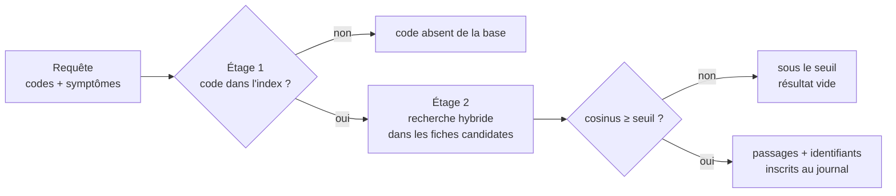

# MécaPilot — Stack technique et conception du RAG

Version de travail · Techathon 6 · novembre 2026

Ce document fixe les choix techniques du prototype. Il complète `mecapilot_specification_agent.md` et le remplace sur deux points :

- le format des fiches (remplace la section 10.1) ;
- le seuil de pertinence, qui se calibre au lieu d'être fixé (la valeur 0,82 de la section 4.1 n'était qu'un exemple).

**Principe des choix** : outils simples, locaux et bien documentés ; aucun framework qui cache le point de passage entre la sortie du LLM et l'affichage, car c'est là que s'exécutent les garde-fous.

---

## 1. Stack technique

### 1.1 Vue d'ensemble

| Couche | Choix | Raison | Alternative |
|---|---|---|---|
| Langage | Python 3.11 | Le code existant exige ≥ 3.10 ; 3.11 est stable pour toutes les bibliothèques | 3.12 |
| Dépendances | pip + `requirements.txt`, environnement `.venv` | Le plus simple pour l'équipe | uv |
| Acquisition | Émulateur maison, python-OBD (`Voiture`), pyserial | Démo sans matériel | ELM327-emulator pour tester le chemin python-OBD |
| LLM | API Claude : Sonnet 5.5 (démo, évaluation), Haiku 5.5 (développement) | Appels d'outils stricts et sortie JSON contrainte | Mistral via la même interface |
| Orchestration | Boucle agent écrite à la main (~150 lignes) | Les garde-fous s'exécutent entre la sortie du LLM et l'affichage | — |
| Schémas | Pydantic v2 | Valide sortie de l'agent, fiches et journal ; génère les schémas JSON | — |
| RAG | Chroma, sentence-transformers + BGE-M3, rank_bm25 | Local, gratuit, filtrage par métadonnées | FAISS |
| Fiches | python-frontmatter + PyYAML | Lecture du bloc YAML en tête de fiche | — |
| Rapports | Jinja2 → Markdown et HTML ; PDF via l'impression du navigateur | Chiffres injectés par gabarit (G8) ; pas de dépendance système | fpdf2 |
| Interface | Streamlit | Une page, Python uniquement, état de session intégré | — |
| Configuration | python-dotenv (`.env`) + `config.yaml` | Clé d'API hors de Git ; source changée en une ligne | — |
| Tests | pytest + faux LLM qui rejoue des réponses enregistrées | Gratuit, rapide, reproductible | — |
| Voix (extension) | Reconnaissance vocale Voxtral adaptée à la darija, ou Whisper | Mélange darija + termes techniques français | — |

### 1.2 `requirements.txt`

```
anthropic
pydantic>=2
chromadb
sentence-transformers
rank-bm25
python-frontmatter
PyYAML
Jinja2
streamlit
python-dotenv
obd
pyserial
pytest
```

Après la première installation qui fonctionne, figer les versions exactes pour toute l'équipe :

```
pip freeze > requirements.lock
```

Les autres membres installent ensuite avec `pip install -r requirements.lock`.

### 1.3 LLM

**Modèles** : `claude-sonnet-5-5` pour la démo et l'évaluation, `claude-haiku-5-5` pendant le développement. Le modèle se choisit dans `config.yaml`.

**Fonctions de l'API utilisées** :

| Fonction | Paramètre | Usage dans MécaPilot |
|---|---|---|
| Strict tool use | `"strict": true` dans la définition de chaque outil | Les arguments de `lire_pid`, `chercher_doc`, etc. respectent toujours leur schéma |
| Sortie JSON | `output_config.format` de type `json_schema` | La réponse de chaque tour respecte le schéma de sortie (section 5.2 de la spécification) |

Les deux se combinent dans la même requête. Le schéma JSON supporté est un sous-ensemble du standard : vérifier les limites dans la documentation (lien en fin de document).

**La validation Pydantic reste obligatoire.** L'API garantit la forme ; Pydantic et les garde-fous vérifient le fond : source existante dans la session, cause présente dans la fiche, mesure plausible.

**Isolation** : tout appel au LLM passe par `agent/llm.py`, qui expose une seule interface :

```python
class ClientLLM(Protocol):
    def tour(self, messages: list, outils: list, schema_sortie: dict) -> ReponseLLM: ...
```

Trois implémentations : `ClientClaude` (réel), `FauxLLM` (tests, rejoue des réponses enregistrées dans `tests/enregistrements/`) et, si besoin, `ClientMistral`. Le reste du code ne connaît que `ClientLLM`.

### 1.4 Configuration

`.env` (jamais commité, `.env` dans `.gitignore`) :

```
ANTHROPIC_API_KEY=...
```

`config.yaml` :

```yaml
source: emulateur                 # emulateur | banc | voiture
scenario: data/scenarios/p0171_prise_air.json
llm:
  modele: claude-haiku-5-5        # claude-sonnet-5-5 pour la démo
rag:
  modele_embeddings: BAAI/bge-m3
  top_k: 5
  seuil_cosinus: null             # à remplir après calibrage (section 2.7)
  date_calibrage: null
fiches:
  accepter_non_validees: true     # false hors prototype
```

Si `seuil_cosinus` vaut `null`, l'agent refuse de démarrer : le seuil doit être calibré.

---

## 2. Conception du RAG

### 2.1 Principe : deux étages

**Un code défaut ne se cherche jamais par similarité.** Pour un modèle d'embeddings, P0172 ressemble à P0171, alors que c'est la panne inverse (mélange trop riche). Une recherche sémantique sur les codes violerait le garde-fou G2.

| Étage | Rôle | Méthode |
|---|---|---|
| 1. Recherche exacte | Trouver les fiches qui couvrent un code | Index `code → fiches` construit depuis le YAML. Code absent → « code absent de la base », fin de la recherche |
| 2. Recherche sémantique | Trouver le bon passage pour des symptômes et fournir la citation | Hybride embeddings + BM25, limitée aux fiches de l'étage 1, ou à toute la base si seuls des symptômes sont donnés |

**Les données structurées ne passent pas par le RAG.** Causes, tests, effets, plages et règles de plausibilité sont lus directement dans le YAML de la fiche, par son identifiant, par `choisir_test`, `reevaluer` et `verifier_plausibilite`. Le RAG sert au texte et aux citations, jamais aux calculs.



### 2.2 Format des fiches

Chaque fiche `data/fiches/F-XXX.md` contient un bloc YAML structuré, lu par le code, puis des sections de texte, indexées par le RAG et affichées au technicien.

```markdown
---
id: F-012
titre: Mélange trop pauvre
codes: [P0171, P0174]
marque: X
organe_securite: false
source: "Manuel de réparation marque X, chapitre …"
valide_par: null              # null = NON VALIDÉ, affiché comme tel

causes:
  C1: Prise d'air à l'admission après le débitmètre
  C2: Débitmètre encrassé
  C3: Pression carburant insuffisante
  C4: Injecteurs colmatés

tests:
  T1:
    description: Correction de mélange au ralenti puis à 2 000 tr/min
    duree_min: 2
    outillage: []
    conditions: {temp_moteur_min_c: 80}
    pids: [LONG_FUEL_TRIM_1, RPM]
    resultats:
      normalisee:   {C1: renforcee, C2: affaiblie, C3: affaiblie}
      reste_elevee: {C1: affaiblie, C2: renforcee, C3: renforcee}
  T2:
    description: Contrôle d'étanchéité de l'admission
    duree_min: 10
    outillage: [machine à fumée]
    resultats:
      fuite_visible: {C1: confirmee}
      aucune_fuite:  {C1: eliminee}

plages:
  LONG_FUEL_TRIM_1: {min: -10, max: 10, unite: "%"}

plausibilite:
  - {pid: MAF, regle: "valeur == 0 and RPM > 500", alerte: "Débitmètre ou connexion"}

vigilance:                    # optionnel : points de prévention sourcés
  - Contrôler l'état des durites d'admission au prochain entretien
---

## Symptômes
Texte libre : ce que le technicien ou le client constate.

## Causes
Explication de chaque cause, avec les indices qui l'orientent.

## Tests
Mode opératoire détaillé de chaque test.

## Vigilance
Contexte des points de prévention.
```

**Règles vérifiées à l'indexation** (modèle Pydantic `Fiche`) :

| Règle | Exemple d'erreur bloquée |
|---|---|
| Champs obligatoires présents : `id`, `titre`, `codes`, `organe_securite`, `source`, `causes`, `tests` | Fiche sans source |
| Chaque cause citée dans `resultats` existe dans `causes` | `C5` utilisé mais non défini |
| Effets limités à `confirmee`, `renforcee`, `affaiblie`, `eliminee` | `probable` |
| Codes au format OBD-II : une lettre P, B, C ou U puis 4 caractères hexadécimaux | `P171` |
| Identifiant unique dans la base | Deux fiches `F-012` |
| Sections attendues présentes dans le texte | Section `## Tests` absente |

Une fiche invalide fait échouer l'indexation avec un message clair. On n'indexe jamais une fiche cassée.

Les règles de `plausibilite` sont évaluées par un petit interpréteur à opérateurs limités (comparaisons, `and`, `or`), **jamais avec `eval()`** de Python.

### 2.3 Indexation

| Élément | Choix |
|---|---|
| Découpage | Une section `##` = un passage. Les fiches sont courtes, pas de redécoupage |
| En-tête de contexte | Chaque passage est indexé avec un préfixe : « Fiche F-012 · Mélange trop pauvre · P0171, P0174 · Section Tests : … » |
| Identifiant | `F-012#tests` : c'est l'identifiant cité par l'agent et vérifié par G1 |
| Métadonnées | `fiche`, `section`, `codes` (texte, séparés par des virgules), `organe_securite`, `marque`, `valide` |
| Stockage | Collection Chroma persistante dans `rag/index/` (hors Git) ; index BM25 sérialisé à côté |
| Manifeste | `rag/index/manifeste.json` : empreinte de chaque fiche, modèle d'embeddings, date. Si une fiche change, l'agent signale qu'il faut réindexer |
| Commande | `python -m rag.indexation` |

### 2.4 Modèle d'embeddings

**Choix : BGE-M3** (`BAAI/bge-m3`), chargé avec sentence-transformers, embeddings normalisés.

| Critère | BGE-M3 |
|---|---|
| Langues | Multilingue : français, et arabe pour une future darija |
| Préfixes requête / document | Aucun : pas de risque d'oubli |
| Taille | 568 millions de paramètres, téléchargement d'environ 2 Go |
| Coût sur une trentaine de fiches | Indexation rapide sur processeur ordinaire |

**Repli pour un ordinateur trop faible** : `intfloat/multilingual-e5-small`. Attention, ce modèle exige le préfixe `query: ` sur les requêtes et `passage: ` sur les documents ; un oubli dégrade les résultats sans message d'erreur. Changer de modèle impose de réindexer et de recalibrer le seuil.

### 2.5 Recherche

1. **Étage 1** : lecture de l'index `code → fiches`. Liste vide → `code_absent: true`, fin.
2. **Recherche par embeddings** (cosinus, BGE-M3) dans les passages des fiches candidates, filtrés par la métadonnée `fiche`.
3. **Recherche par mots-clés** (BM25) sur les mêmes passages. Tokenisation : minuscules, accents conservés, codes défauts gardés intacts.
4. **Fusion** par *reciprocal rank fusion* : `score = Σ 1 / (60 + rang)` sur les deux classements.
5. **Top 5** après fusion.
6. **Seuil** : un passage n'est conservé que si son **cosinus** (étage embeddings) atteint `seuil_cosinus`. Le score de fusion sert à classer, pas à filtrer. Aucun passage conservé → `sous_seuil: true`.
7. **Journal** : chaque identifiant renvoyé est inscrit (`recherche_doc`). G1 n'accepte que ces identifiants comme citations.

La distance cosinus doit être configurée explicitement à la création de la collection Chroma (syntaxe selon la version installée).

### 2.6 Sortie de `chercher_doc`

```json
{
  "resultats": [
    {"id": "F-012#tests", "fiche": "F-012", "section": "tests",
     "cosinus": 0.71, "rang_fusion": 1,
     "valide": false, "organe_securite": false,
     "passage": "…"}
  ],
  "code_absent": false,
  "sous_seuil": false
}
```

- `valide: false` → l'interface affiche le badge « NON VALIDÉ ».
- `organe_securite: true` → l'agent passe à l'état `OrganeSecurite` (G3), même si le passage est pertinent.

### 2.7 Calibrage du seuil

Les scores de similarité dépendent du modèle : un seuil ne se devine pas.

1. Écrire `eval/requetes_rag.json` : au moins 10 requêtes **positives** (fiche et section attendues) et 10 **négatives** (symptômes sans fiche dans la base).
2. Lancer `python -m eval.calibrer_seuil` : le script affiche le cosinus du meilleur passage pour chaque requête.
3. Choisir le seuil qui laisse passer les positives et bloque les négatives. S'il n'existe pas, la base ou les requêtes sont à revoir.
4. Reporter `seuil_cosinus` et `date_calibrage` dans `config.yaml`.
5. Recalibrer à chaque changement de modèle d'embeddings ou ajout important de fiches.

`eval/requetes_rag.json` devient aussi un test automatique.

### 2.8 Indicateurs de qualité

| Indicateur | Cible prototype |
|---|---|
| Bonne fiche parmi les 3 premiers résultats (requêtes positives) | ≥ 90 % |
| Requêtes négatives qui renvoient un passage | 0 |
| Codes absents traités comme présents | 0 (garanti par l'étage 1) |
| Fiches invalides indexées | 0 (garanti par la validation) |

### 2.9 Hors prototype

- Reranker : inutile sur une trentaine de fiches, à envisager au-delà de quelques centaines.
- Versions de fiches et historique des validations.
- Bulletins techniques et campagnes de rappel comme second type de document.

---

## 3. Ajouts à l'organisation du dépôt

```
agent/llm.py                 interface ClientLLM, ClientClaude, FauxLLM
rag/fiche.py                 modèle Pydantic Fiche et validation
rag/indexation.py            construction de l'index et du manifeste
rag/recherche.py             étages 1 et 2, fusion, seuil
rag/index/                   index Chroma et BM25 (hors Git)
eval/requetes_rag.json       requêtes de calibrage et de test
eval/calibrer_seuil.py       calcul des scores pour le calibrage
tests/enregistrements/       réponses LLM rejouées par FauxLLM
config.yaml                  configuration
.env                         clé d'API (hors Git)
requirements.txt / .lock     dépendances
```

---

## 4. Références

- Sortie JSON contrainte (Claude API) : https://platform.claude.com/docs/en/build-with-claude/structured-outputs
- Appels d'outils stricts (Claude API) : https://platform.claude.com/docs/en/agents-and-tools/tool-use/strict-tool-use
- BGE-M3 : https://huggingface.co/BAAI/bge-m3
- python-OBD : https://python-obd.readthedocs.io
